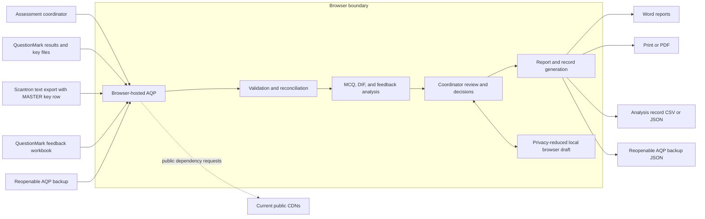

# AQP documentation update for Claude and institutional IT

**Prepared:** October 14, 2026
**Application:** Assessment Quality Platform (AQP)
**Current version:** `1.0.0-beta.1`
**Verified architecture baseline:** build `20261011-01`
**Purpose:** Supply verified, current information for Claude to merge into the existing institutional documentation before the October 16, 2026 IT discussion.

> **November 9, 2026 addendum:** Application build `20261109-01` adds plain-language report guidance for the **Best students chose** column, intentional em dashes for inapplicable cells, and aligned explanatory terminology. It does not change the solution architecture, data flow, privacy model, statistical calculations, thresholds, integrations, or institutional requirements documented below.

## Instructions for Claude

Merge the facts in this update into the existing AQP documentation rather than replacing the existing document structure wholesale.

When merging:

1. Treat **Current verified state** as the verified architecture baseline implemented in version `1.0.0-beta.1`, build `20261011-01`; apply the November 9 addendum for the current build identity.
2. Treat **Recommended institutional state** as proposed future architecture, not completed functionality.
3. Preserve **Open institutional decisions** as questions for IT, Privacy, Security, Records Management, Accessibility, and the academic program owner.
4. Remove or revise superseded statements, including any claim that the application is still version `0.8`, lacks retained regression tests, has only a 40-student/12-question demonstration, or has an active production login.
5. Do not describe the sign-in preview as authentication. No credentials are requested, validated, or stored.
6. Do not describe Elentra, SharePoint, QuestionMark, Scantron, or Microsoft identity as live API integrations. QuestionMark and Scantron are currently file-based inputs; the others are future integration candidates.
7. Keep architecture descriptions separated into **current state**, **transition option**, and **future institutional state**.
8. Preserve existing approved institutional terminology and document formatting where it does not conflict with the verified facts below.
9. Keep the existing version/build history and build identifiers. This documentation update does not change the application version or build.
10. Flag conflicts between this update and existing institutional documentation for human review rather than silently choosing an interpretation.

---

## 1. Executive summary

AQP is a browser-based assessment-review application for University of Ottawa Undergraduate Medical Education. It imports QuestionMark or Scantron examination data and QuestionMark student-feedback exports, validates the uploaded structures, performs item and differential item functioning analyses, supports coordinator review decisions, and creates review-ready reports and structured records.

The current application is a static, client-side system. It has no AQP application server, central database, production authentication, shared workspace, or direct institutional-system API connection. Uploaded files are read and analysed locally in the user's browser. The application can be opened as a static file or hosted as static web content, subject to the availability of its current public content-delivery-network dependencies.

The functional architecture is substantially complete for the current single-user, one-active-session-at-a-time model. The remaining major architectural decisions belong to the institutional transition: approved hosting, authentication, authorization, managed storage, collaboration, retention, centralized auditing, dependency hosting, and support ownership.

Version `1.0.0-beta.1` indicates that the product is approaching institutional launch but has not yet reached the institutionally deployed `1.0.0` release. Build `20261011-01` was the current build when this architecture baseline was prepared; build `20261109-01` subsequently added report guidance without changing the architecture described here. The October 14 validation and documentation work was intentionally treated as a catch-up/evidence pass rather than a new release.

## 2. Scope and intended users

### Current purpose

AQP supports assessment coordinators and reviewers by converting existing exports into an explainable review workspace. It does not author examinations, deliver examinations, assign final academic decisions, or replace expert review.

### Current supported analysis types

- Multiple-choice item analysis
- Differential item functioning (DIF) analysis by configured language stream
- Combined MCQ and DIF review
- Student-feedback parsing, mapping, categorization, and review
- Feedback-only analysis

### Current principal outputs

- MCQ analysis Word report
- DIF Word report
- Combined MCQ+DIF Word report
- Feedback Word report
- Browser print-to-PDF previews
- MCQ and DIF CSV exports
- Privacy-minimized Analysis record in CSV and JSON
- Reopenable AQP backup in JSON

### Current users and operating boundary

- One analyst works in one browser with one active saved draft.
- Multiple people may independently open the application, but they do not share state.
- Review reports or downloaded backups must currently be transferred through approved external processes.
- Role-based access, shared workspaces, approvals, and centralized history are not implemented.

## 3. Solution architecture

### 3.1 Current verified state

| Layer | Current implementation |
| --- | --- |
| User interface | One static `index.html` containing application markup, styles, state, parsing, calculations, navigation, and export logic |
| Execution | JavaScript in the user's web browser |
| Input | User-selected local files: QuestionMark Excel/CSV, Scantron tab-delimited text, QuestionMark feedback Excel, and Reopenable AQP backup JSON |
| Processing | Deterministic local parsing, reconciliation, scoring, classical item analysis, DIF modelling, feedback mapping, review-state management, and document construction |
| Temporary state | Browser memory while the page is open |
| Recoverable local state | One privacy-reduced browser draft in `localStorage`, expiring after 30 days, plus saved theme preferences |
| User-controlled persistence | Downloaded Word, CSV, JSON, and browser-generated PDF files |
| Server/database | None in the current application |
| Authentication | Preview interface only; no credential capture or validation |
| Deployment | Static HTML file or static hosting |
| Testing | Seven browser suites plus independent Python statistical validation |

### 3.2 Current logical component model

The current file contains these logical components even though they have not yet been physically separated into source modules:

1. Application shell, navigation, theme, branding, splash, and sign-in preview
2. File reading and format detection
3. QuestionMark results and answer-key parsing
4. Scantron parsing, including the `MASTER` answer-key row
5. Upload validation and analysis reconciliation
6. MCQ scoring, reliability, difficulty, discrimination, and flags
7. DIF modelling, safeguards, suppression reasons, and presentation
8. Feedback workbook detection, deterministic parsing, mapping, and categorization
9. Coordinator exceptions, Near Threshold decisions, Review Queue, and feedback edits
10. Browser-draft persistence and Reopenable AQP backup import/export
11. Analysis-record, CSV, JSON, HTML preview, PDF/print, and Word-report generation
12. Accessibility utilities, dialogs, focus management, and announcements
13. Synthetic demonstration and retained test fixtures

### 3.3 Architecture diagram — current state

No application data flow to an AQP server exists in the current architecture. The public CDN requests retrieve application libraries or fonts. They should not receive uploaded exam content by design, but their use still creates external network requests and must be reviewed by IT.

### 3.4 Recommended institutional state

The final production design must be selected with IT. A likely institutional direction includes:

- Institutionally approved static or application hosting
- Microsoft or university identity authentication
- Role-based authorization for coordinators, reviewers, directors, administrators, and support personnel
- Approved managed storage, potentially SharePoint/Microsoft 365 or another institutional platform
- Centralized audit, retention, and access logging
- Controlled handoff and approval workflow
- Institution-hosted or bundled third-party dependencies
- Environment-specific configuration, security headers, monitoring, backup, and recovery

These capabilities are not prerequisites for understanding or maintaining the current analysis logic. They are required when the operating model expands beyond an individual analyst working locally.

### 3.5 Planned modular-development transition

The current single-file artifact remains deployable and tested, but its source is difficult to review and maintain. A modularization plan is approved in principle:

- Separate editable source into understandable modules.
- Continue producing one deployable `index.html` unless IT selects another packaging model.
- Make no calculation, interface, report, upload, or workflow changes during extraction.
- Use a protected pre-modularization tag/branch and small reversible commits.
- Regenerate the deployment artifact and run the full suite after every extraction step.

Modularization has **not** been completed. It should be sequenced after the immediate IT documentation discussion so the build and packaging approach can reflect IT guidance.

## 4. Data flow and data handling

### 4.1 Primary analysis flow

1. The user selects analysis type, source format, language codes, exam title, and exam date.
2. The user selects local upload files.
3. The browser reads the files using browser file APIs and JavaScript parsers.
4. AQP validates structure and content before analysis.
5. The Analysis reconciliation view explains what was detected, included, excluded, blocked, or flagged for review.
6. After confirmation, AQP reconstructs scores from responses and the answer key.
7. AQP performs the selected MCQ, DIF, and/or feedback analyses.
8. The coordinator reviews flags, mapping, exceptions, Near Threshold candidates, and Review Queue items.
9. AQP generates reports, records, or a reopenable backup at the user's request.
10. Files are downloaded through the browser to a user-selected or browser-configured location.

### 4.2 Inputs and validation

| Input | Format | Current treatment |
| --- | --- | --- |
| QuestionMark results | `.xlsx`, `.xls`, or `.csv`; original `.xlsx` preferred | Validates structure, identifiers, question pairs, outcomes, score values, streams, exclusions, and cross-file identity |
| QuestionMark answer key | `.xlsx`, `.xls`, or `.csv` | Validates answer range, count, item identity/version, wording, ordering, and Score/Outcome pairs |
| Scantron results | Tab-delimited `.txt` | Reads answer key from the row identified as `MASTER`; validates 1–5 responses, identifiers, row length, and course codes |
| Student feedback | QuestionMark `.xlsx` | Detects supported worksheets/columns or conservative headerless layout; parses and maps comments deterministically |
| Reopenable AQP backup | AQP JSON file | Validates file type, schema version, size, field whitelist, structure, values, and compatibility before replacement |

The October 14 upload gap audit confirmed retained coverage for malformed files, duplicate and blank identifiers, duplicate question identifiers, invalid responses or keys, mixed scored/Unscored states, stream warnings, cross-file mismatches, stale-state clearing, feedback layout ambiguity, file bounds, and CSV quoting. It also added explicit protection for numbered outcomes outside 1–5, incomplete Score/Outcome pairs, and multiple possible disclosure/consent items.

### 4.3 Data held in memory

During an active session, browser memory may contain:

- Student names and institutional identifiers from source files
- Item responses and reconstructed scores
- Language/course stream codes
- Answer keys, item text, and item identifiers
- Feedback comments
- Coordinator mappings, exceptions, rationales, sign-offs, and notes
- Generated report content

Closing or reloading the page removes in-memory state unless a browser draft is restored. Device/browser compromise remains outside the application's direct protection.

### 4.4 Browser draft

AQP may save one active recovery draft in `localStorage` after significant analysis or review changes.

- The draft expires after 30 days.
- Student names and institutional identifiers are excluded.
- De-identified item responses and feedback text may remain because they are required to restore the working analysis.
- Exceptions, Near Threshold decisions, Review Queue decisions, and feedback edits may be retained.
- Clearing browser data removes the draft.
- The Privacy & local data control can remove the draft explicitly.
- Theme and appearance preferences can be cleared separately.

### 4.5 Analysis record

The Analysis record is a privacy-minimized report/integration output available in CSV and JSON.

It contains exam-level and item-level results, DIF detail, feedback counts, thresholds, timestamps, validation outcomes, review decisions, suppression reasons, source filenames/fingerprints, and other audit information. It does not contain student names, institutional identifiers, individual response records, or feedback comment text.

The Analysis record is not importable and cannot restore a working session.

### 4.6 Reopenable AQP backup

The Reopenable AQP backup is a versioned JSON recovery format.

- It is intended to reopen the working analysis on the same or another device.
- It contains de-identified response-level data, coordinator decisions, and feedback comment text when present.
- It excludes student names and institutional identifiers.
- It uses a recognized file type and session-schema version.
- Import validates the file and shows a preview before replacing current work.
- AQP recalculates the analysis rather than trusting stored display results.

Because this backup contains response-level and free-text data, it requires stronger handling than the privacy-minimized Analysis record.

### 4.7 Downloads and control boundary

Once a report, Analysis record, or backup is downloaded, it is outside AQP's control. Clearing AQP browser data cannot delete downloaded files, email attachments, SharePoint copies, local backups, or files copied to other devices. Institutional storage, sharing, retention, and destruction controls must govern those artifacts.

## 5. Prioritized business requirements

The following priorities reflect current product decisions and technical evidence. Institutional owners should confirm final priority and acceptance criteria.

### Priority A — required for the current assessment-review function

| Requirement | Current status |
| --- | --- |
| Import established QuestionMark and Scantron exam exports without manual data transformation | Implemented |
| Treat the Scantron row identified as `MASTER` as the answer key | Implemented and tested |
| Import supported QuestionMark feedback exports, including observed headerless layouts | Implemented and tested |
| Block structurally invalid or unsafe-to-interpret uploads before analysis | Implemented with retained malformed-file suite |
| Explain exclusions, mismatches, missing responses, and stream issues before analysis | Implemented through upload validation and reconciliation |
| Reconstruct scoring from the answer key rather than silently trusting source score columns | Implemented |
| Calculate item difficulty, discrimination, reliability, flags, and recommendations deterministically | Implemented and independently validated |
| Perform bilingual DIF analysis with conservative sparse/non-estimable safeguards | Implemented and independently validated |
| Keep “Unable to assess” distinct from “No DIF detected” | Implemented |
| Permit coordinator exceptions, mappings, category changes, discard decisions, and review sign-off | Implemented |
| Produce review-ready Word reports and structured records | Implemented and regression tested |
| Preserve an auditable, reproducible record of source interpretation and decisions | Implemented |
| Support feedback-only, MCQ-only, and combined workflows without irrelevant-room confusion | Implemented |
| Provide an anonymized demonstration suitable for training and testing | Implemented: 180 students, 70 questions, 130 English, 50 French, plus feedback |

### Priority B — required before institutional production launch

| Requirement | Owner/status |
| --- | --- |
| Approved hosting and deployment model | IT decision required |
| Institutional authentication and session management | IT/IAM implementation required |
| Role and authorization model | Business owner, Privacy, Security, and IT decision required |
| Approved storage and sharing rules for reports and backups | Privacy/Records/IT decision required |
| Third-party dependency packaging and security-header approach | IT decision required |
| Privacy assessment and records-retention approval | Institutional review required |
| Human assistive-technology validation on supported devices | Accessibility/user validation outstanding |
| Support model, ownership, incident path, and release process | Operational decision required |
| Production browser/device support matrix | IT decision required |
| Final user-acceptance testing using privacy-safe or approved operational data | Joint business/IT validation required |

### Priority C — important when collaboration or longitudinal use begins

- Managed shared storage
- Multi-user roles and permissions
- Coordinator-to-coordinator handoff
- Formal approval workflow
- Centralized audit logs
- Longitudinal exam and item history
- Direct report archiving
- Backup-schema migration when future schemas change
- Anonymized diagnostics/support export
- Report approval metadata if required by committee workflow

### Deferred pending demonstrated need or governance approval

- Distractor Analysis standalone report/export
- Combined MCQ+DIF report redesign
- Automated narrative analysis summaries
- AI-assisted classification, interpretation, or report writing
- Unified Review redesign

## 6. Identified integration requirements

### 6.1 Current file-based interoperability

| System or source | Current relationship |
| --- | --- |
| QuestionMark | File-based import of results, answer key, and feedback exports; no API connection |
| Scantron | File-based import of tab-delimited export; answer key read from `MASTER` row; no API connection |
| Elentra | Item identifiers may be displayed and exported to help users locate questions; no direct API or item-bank connection |
| Microsoft Word | AQP constructs and downloads `.docx` reports in the browser |
| Excel/CSV consumers | AQP produces CSV records and accepts supported CSV imports for QuestionMark data |
| Browser PDF | Report preview uses the browser print workflow for PDF output |

### 6.2 Authentication integration

The current sign-in card is a visual placeholder. IT must determine:

- Identity provider and protocol
- Required institutional account population
- Role claims and group mapping
- Session lifetime and inactivity timeout
- Sign-out behaviour
- Conditional-access and multifactor-authentication expectations
- Whether local/static deployment remains permissible after authentication is introduced

### 6.3 Managed-storage integration

Potential SharePoint/Microsoft 365 or equivalent requirements include:

- Approved location for reports, Analysis records, and reopenable backups
- Naming and metadata conventions
- Access-control inheritance
- Retention labels and disposition
- Version history
- Approval workflow
- Central audit records
- Conflict and concurrent-edit behaviour
- Recovery and business continuity

No managed-storage connector currently exists.

### 6.4 Elentra integration

The current application extracts and displays Elentra-style item identifiers where available. A future integration would require:

- Confirmed authoritative item identifier and version contract
- Read/write scope and API availability
- Authentication and service authorization
- Rules for linking AQP review decisions to item-bank records
- Ownership of corrections and synchronization conflicts
- Controls preventing AQP statistical signals from becoming automatic item decisions

### 6.5 QuestionMark and Scantron integration

The current file-based approach is operationally simple and keeps source systems decoupled. A future automated integration would require:

- Supported export/API contracts and versioning
- Credential and secret management
- Exam/session selection and authorization
- Transfer encryption and logging
- Error recovery and partial-import rules
- Clear ownership when source-system structures change

File import should remain available as a controlled fallback unless IT directs otherwise.

## 7. Dependencies, constraints, and impacts

### 7.1 Runtime dependencies

The current HTML references these public resources:

- SheetJS/XLSX `0.18.5` from cdnjs
- JSZip `3.10.1` from cdnjs
- html2canvas `1.4.1` from cdnjs
- Inter font from Google Fonts

Fluent interface icons and the AQP brand assets are embedded locally. Test tooling includes Node.js and Playwright. Independent validation uses Python, NumPy, SciPy, statsmodels, and openpyxl in an isolated validation environment.

### 7.2 Key constraints

- The development source is currently one large HTML file.
- The current public dependencies mean a completely offline opening may not provide all functionality or intended typography.
- Browser storage is device/profile-specific and supports only one active draft.
- There is no server-side authorization, collaboration, centralized audit, or managed retention.
- Downloads depend on users following approved storage and sharing practices.
- Browser and device policy can affect file access, downloads, printing, storage, and JavaScript execution.
- Statistical safeguards reduce inappropriate conclusions but do not replace methodological review.
- Free-text feedback can contain unexpected personal information.
- Current reports are English-language interfaces/content unless separately localized; bilingual analysis refers to student streams, not complete application translation.

### 7.3 Impacts of institutionalization

Introducing authentication and managed storage changes AQP from a standalone local tool into an institutionally operated information system. Expected impacts include:

- Privacy and security assessment scope increases.
- Roles, access reviews, audit ownership, retention, and incident response must be formalized.
- Hosting, configuration, dependency patching, release management, and support become institutional responsibilities.
- User workflow may gain sign-in, save location, case ownership, collaboration, and approval steps.
- Existing local backup and draft behaviour may need to be disabled, restricted, or reclassified.
- Data models may require migrations and stable integration contracts.
- Operational monitoring must avoid collecting sensitive uploaded content unnecessarily.

### 7.4 Impact of modularization

Modularization is expected to improve code review, testing, ownership, onboarding, and diagnosis. It should not change the deployment artifact or user experience unless IT selects a different packaging model.

The transition risk is behavioural drift while moving logic. The approved controls are a frozen baseline, protected rollback point, small extraction commits, regenerated artifact checks, full automated testing after each step, and stop conditions for any statistical, upload, report, recovery, visual, or accessibility regression.

## 8. Security and privacy

### 8.1 Current verified safeguards

- Processing occurs in the browser rather than an AQP server.
- Student names and institutional identifiers are excluded from browser drafts and Reopenable AQP backups.
- Analysis records omit student-level responses and feedback comment text.
- Backup import uses file-type, schema, size, structure, field, and value validation.
- Imported text is rendered as text rather than intentionally executed as markup or code.
- Draft replacement requires confirmation.
- Users can inspect and clear locally stored AQP data.
- Uploaded structures are validated before analysis.
- Calculations and categorizations are deterministic and coordinator-reviewable.
- The audit record captures inputs, fingerprints, thresholds, exclusions, warnings, decisions, timestamps, and export events.
- Demonstration mode supports training without real student data.
- Regression tests cover malformed uploads, session recovery, reports, exports, accessibility, and statistical results.

### 8.2 Sensitive data processed

- Direct identifiers in uploaded source files
- Individual exam responses and scores
- Language/course stream membership
- Confidential answer keys and assessment content
- Student feedback text
- Coordinator notes, rationales, and decisions
- Source filenames that may themselves contain sensitive information

### 8.3 Material risks

| Risk | Current position | Required institutional response |
| --- | --- | --- |
| Shared or unattended workstation | Privacy-reduced draft may remain locally | Decide whether drafts are permitted and define workstation clearing/sign-out rules |
| Downloaded files stored or sent incorrectly | Outside AQP control after download | Define approved repositories, encryption, sharing, disposal, and user training |
| Free-text feedback contains identifiers or sensitive content | Remains local but may enter backup/report workflows | Define reviewer/redaction expectations and output rules |
| Public CDN requests | Retrieve libraries/fonts; uploaded data is not intentionally sent | Decide whether to bundle or institutionally host dependencies and apply CSP/SRI/security headers |
| No production authentication | Anyone with application/file access can open the current tool | Implement approved authentication and authorization before managed multi-user deployment |
| Device or browser compromise | Outside application boundary | Require managed devices, supported browsers, patching, endpoint protection, and conditional access as appropriate |
| Sensitive filenames in audit metadata | Supports reproducibility but may expose context | Establish filename conventions or approved transformation/removal rules |
| Retention and record status unclear | Downloads and decisions are manually managed | Define record classes, owners, locations, periods, holds, and destruction |
| Incident process undefined | No application-specific institutional procedure | Assign reporting, containment, investigation, escalation, and notification responsibilities |

### 8.4 Open privacy and security decisions

1. Who is authorized to upload student-level assessment files?
2. Which roles may view DIF, feedback, answer keys, reports, or response-level backups?
3. Are browser drafts allowed on managed devices, shared devices, both, or neither?
4. Which repository is approved for reports and Reopenable AQP backups?
5. Which outputs constitute official institutional records?
6. What retention and destruction schedules apply?
7. May filenames contain course, exam, student, or instructor information?
8. Is language-stream DIF approved for the documented educational purpose, and who may review it?
9. What authentication, authorization, timeout, logging, and access-review controls are required?
10. What is the incident-response path for misdirected, lost, or exposed files?
11. Must the application operate without internet access?
12. Are public CDNs allowed, or must all dependencies be bundled or institutionally hosted?
13. What telemetry, if any, is permitted, and how will it avoid sensitive content?
14. Who approves the final privacy, security, records, accessibility, and methodology positions?

## 9. Quality, verification, and release evidence

### 9.1 Automated browser coverage

The current `npm test` command runs seven suites covering:

1. Golden parser, scoring, item, DIF, and feedback expectations
2. Missing-response, single-language, and small-sample fixtures
3. Feedback parser formats and category precedence
4. Exceptions, persistence, session round-trip, previews, CSV/JSON, and four Word reports
5. Malformed QuestionMark, Scantron, answer-key, feedback, workbook-bound, and CSV cases
6. Demonstration, audit trail, report readiness, DIF suppression, exports, and recovery
7. Keyboard, focus, dialog, switch, target-size, reduced-motion, and narrow-reflow accessibility checks

### 9.2 Independent statistical evidence

- Synthetic golden exam: 112 of 112 independent comparisons passed.
- First supplied operational exam: 1,138 aggregate and per-question comparisons passed; the privacy-safe result is retained outside Git under the ignored private-validation folder.
- Realistic demonstration: 180 students, 70 questions, 68 independently estimable DIF models, 7 formal DIF signals, and 2 safeguarded questions.
- Edge package: missing-response, single-language, and small-sample datasets independently validated.

This evidence supports computational consistency. It is not a substitute for external methodological approval or institutional acceptance.

### 9.3 Remaining validation

- Human keyboard-only and screen-reader validation, including VoiceOver and NVDA
- Supported university device/browser validation
- Additional anonymized operational datasets when materially different formats appear
- Final privacy, security, records, accessibility, and user-acceptance sign-off
- Production authentication, authorization, storage, and deployment testing after IT architecture is selected

## 10. Current-state versus target-state summary

| Area | Current state | Institutional target decision |
| --- | --- | --- |
| Hosting | Static local or static web content | Approved institutional hosting model |
| Authentication | Preview only | Institutional identity and session controls |
| Authorization | None inside AQP | Role-based access and review |
| Processing | Browser-local | Retain local processing or approve managed services |
| Storage | Browser draft and user downloads | Approved managed repository and retention |
| Collaboration | Manual report/backup transfer | Shared cases, handoff, and/or approval workflow |
| Audit | Embedded analysis/audit record | Central audit and access logging if required |
| Dependencies | Public CDNs plus embedded assets | Bundle, pin with safeguards, or institutionally host |
| Development source | Single HTML file | Modular source producing approved deployment artifact |
| Integration | File-based imports/exports | IAM, storage, Elentra, source-system, or workflow integrations as approved |
| Support | Development/testing workflow | Named product, technical, privacy, security, and service owners |

## 11. Recommended decisions for the October 16 IT discussion

The meeting does not need to settle every future feature. The most useful immediate outcomes are:

1. Confirm whether the current static/browser-local model is acceptable for a controlled pilot.
2. Identify the preferred production hosting environment.
3. Confirm the institutional identity/authentication direction.
4. Identify the approved location for reports and Reopenable AQP backups.
5. Decide whether browser recovery drafts may be used on managed or shared devices.
6. Decide whether third-party libraries must be bundled or institutionally hosted.
7. Identify required roles, even if role enforcement is implemented later.
8. Assign owners for privacy, security, records management, accessibility, application support, and academic methodology.
9. Confirm whether SharePoint/Microsoft 365 is the intended collaboration and approval platform.
10. Confirm whether modularization should continue to produce one self-contained HTML file or a conventional hosted web bundle.

## 12. Near-term development status

The application is nearing the end of the current development phase. Remaining work is mainly transition, validation, and maintainability work rather than reconstruction of the analysis workflow.

### Technically ready or substantially complete

- Core upload, validation, analysis, review, report, record, and recovery workflows
- Demonstration data and automated regression coverage
- Independent statistical validation package
- Current privacy data inventory and risk draft
- Rollback-controlled modularization plan

### Remaining before or during IT handover

- IT architecture and deployment decisions
- Institutional privacy/security/records review
- Human assistive-technology validation
- Modular source extraction after IT confirms packaging direction
- Support and release ownership
- Any integration implementation approved by IT

### Remaining product backlog that does not block the architecture discussion

- Anonymized diagnostic export
- Additional operational statistical datasets
- Report approval metadata if required
- Longitudinal analysis and shared workflow after managed storage exists
- Deferred report/narrative concepts only when a demonstrated business need exists

## 13. Evidence and repository references

Claude should use these files as supporting evidence when reconciling the existing documentation:

- `index.html` — current deployable application and embedded FAQ/release history
- `AQP_FORWARD_RECOMMENDATIONS.md` — authoritative forward backlog and completed-item notes
- `AQP_PRIVACY_REVIEW_DRAFT.md` — privacy data inventory, risks, and institutional questions
- `AQP_UPLOAD_VALIDATION_GAP_AUDIT.md` — current upload-validation coverage and October 14 gap closure
- `AQP_MODULARIZATION_ROLLBACK_PLAN.md` — modularization safeguards and rollback approach
- `AQP_CHANGE_SUMMARY_2026-09-23.md` — detailed development history
- `validation/README.md` — independent validation package and reproduction instructions
- `validation/INDEPENDENT_STATISTICAL_VALIDATION.md` — synthetic golden comparison
- `validation/REALISTIC_DEMO_VALIDATION.md` — 180-student demonstration validation
- `validation/EDGE_CASE_STATISTICAL_VALIDATION.md` — missing-response, single-language, and small-sample validation
- `validation/FEEDBACK_PARSER_VALIDATION.md` — deterministic feedback-parser rules and evidence
- `tests/golden/README.md` and `package.json` — retained automated test coverage and commands
- `THIRD_PARTY_NOTICES.md` — bundled/used third-party licensing information

## 14. Suggested wording for the documentation's architecture conclusion

> AQP's current functional architecture is mature for a single-user, browser-based assessment-review workflow. Its upload, validation, analysis, review, reporting, recovery, audit, and demonstration capabilities are implemented and protected by automated and independent validation. The principal remaining architecture work is institutionalization: selecting approved hosting and dependency packaging, connecting identity and role controls, defining managed storage and retention, assigning operational ownership, and deciding whether future collaboration and integration should use SharePoint/Microsoft 365 or another approved platform. The proposed source modularization improves maintainability while preserving the verified deployment behaviour and should proceed after IT confirms the preferred packaging and hosting direction.
